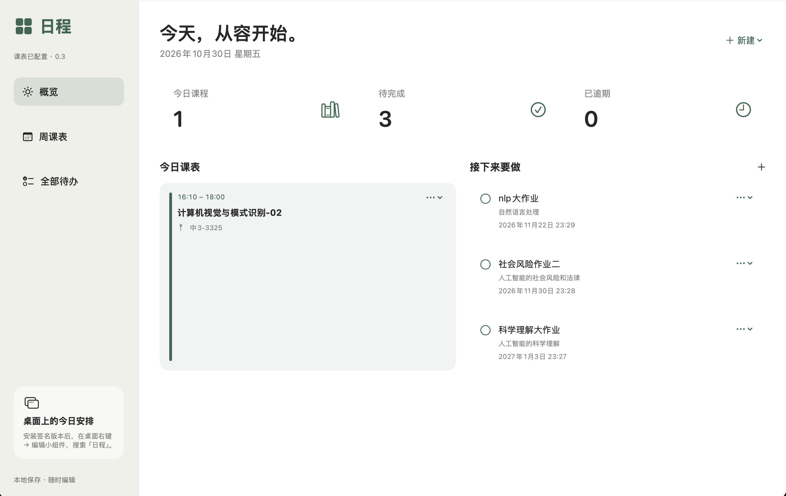
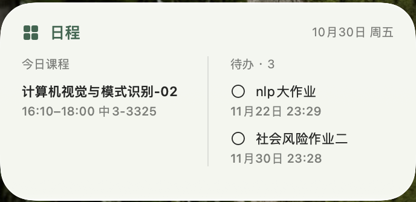

# 日程

一个使用 SwiftUI 和 WidgetKit 编写的 macOS 课程与待办应用。此仓库是可自行构建的源码示例，不包含已公证的发行安装包。

**<mark>建议下载后在agent的帮助下完成安装</mark>**

## 功能

- 周一至周日、按第 1–10 节排列的课表网格；无课时段留空。
- 手动新增、编辑、删除课程，设置课程有效日期。
- 作业与其他待办、截止时间、完成勾选。
- 小、中、大三种桌面小组件，展示今日课程与待办。
- 本地保存；配置共享 App Group 后，应用与小组件共用数据。

默认课表为空，不附带个人课程或账号配置。当前界面不包含手动 JSON、图片或 PDF 导入；仓库保留的导入模型、OCR 源码仅供后续开发。





## 本机预览

需要 macOS 14+ 和兼容的 Apple 开发工具。运行：

```sh
./Scripts/build-preview.sh
open build/日程.app
```

预览版使用本地临时签名，**不包含可安装的小组件**。按本机架构编译；并未验证所有 macOS 版本和 Intel 设备。预览数据保存在 `~/Library/Application Support/ScheduleExample/campus-data.json`，与原作者自用应用隔离。

## 使用 Xcode 构建小组件

1. 打开 `CampusDesk.xcodeproj`。
2. 为 CampusDesk 和 CampusWidget 两个 target 选择自己的签名团队，并设置自己拥有的 Bundle Identifier；扩展标识以主应用标识为前缀。
3. 两个 target 配置同一个 App Group，并把 `CAMPUS_APP_GROUP` 构建设置改为对应的完整组标识。默认值是 `$(DEVELOPMENT_TEAM).group.local.schedule.sample`，须按自己的团队配置。
4. 选择 CampusDesk scheme 和 My Mac，构建运行。打开应用创建共享数据，再到桌面右键 → 编辑小组件，搜索“日程”。

签名、App Group 能力及配置文件需由构建者自己的账号提供；本仓库不包含证书或私钥。不保证免费个人团队能使用所有能力。小组件刷新由系统调度，不保证立即刷新。

`Scripts/generate-project.py` 可重新生成工程，但会重置手动修改过的团队和工程配置，请谨慎使用。

## 测试

在仓库根目录执行：

```sh
swiftc -D LOCAL_PREVIEW -parse-as-library Shared/Models.swift Tests/ImportTests.swift -o /tmp/schedule-import-tests
/tmp/schedule-import-tests Examples/schedule.example.json
swiftc -D LOCAL_PREVIEW -parse-as-library Shared/Models.swift App/OCR.swift Tests/SmokeTests.swift -o /tmp/schedule-model-tests
/tmp/schedule-model-tests --models-only
```

示例文件使用虚构课程。现有课表布局采用固定的学校节次作息（每年 5 月 1 日与 10 月 1 日切换），并不是任意学校通用的课程配置器；单双周、通知、云同步与自动更新尚未实现。

## 发布和许可

上传源码到 GitHub 不需要 Apple 开发者付费会员。把应用作为正常下载安装包对外发布，则应另行处理发布签名、公证和兼容性验证。

此项目尚未选择开源许可证。公开仓库不等同于授予任意修改和再分发许可；作者确定许可后再添加 LICENSE。
